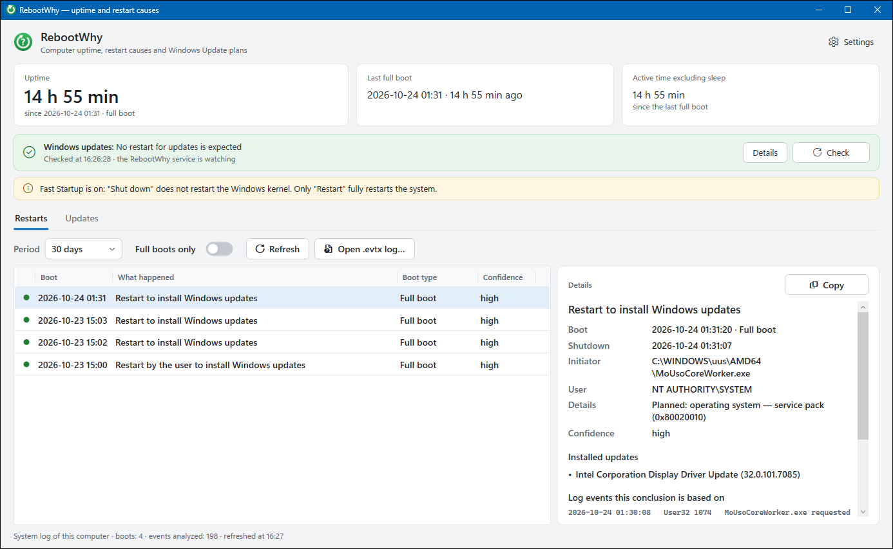
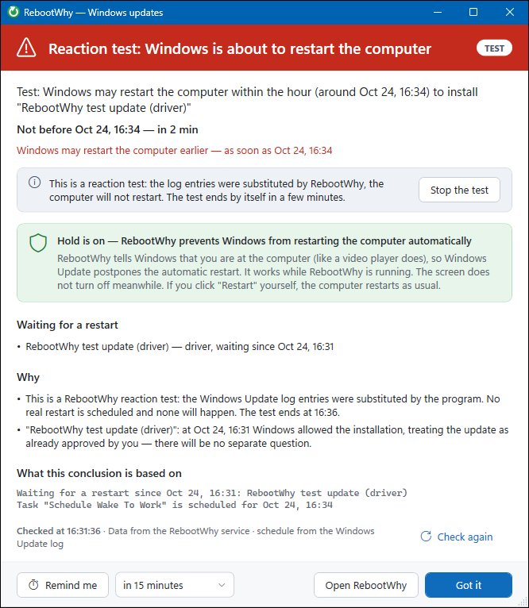
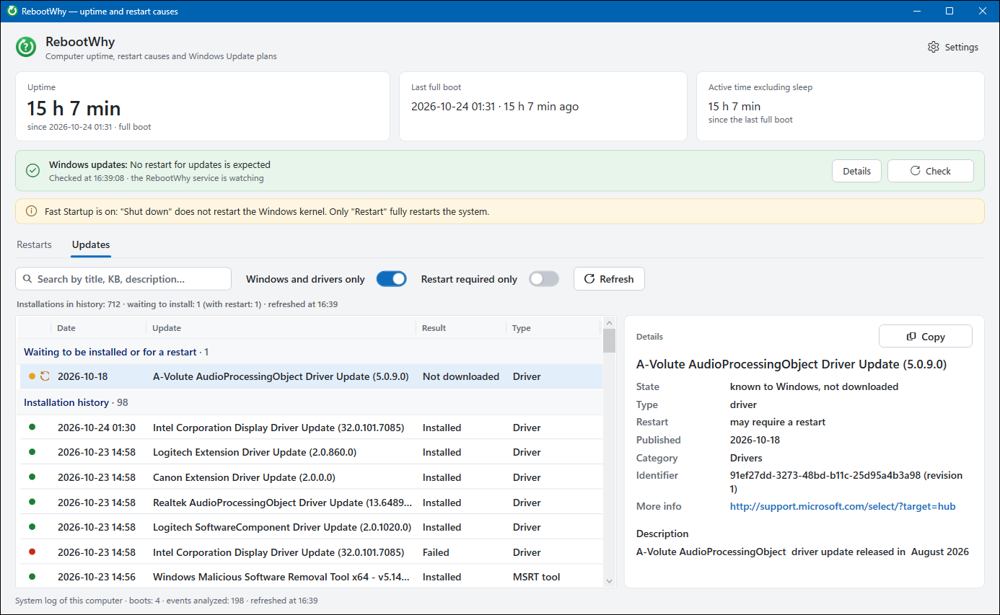
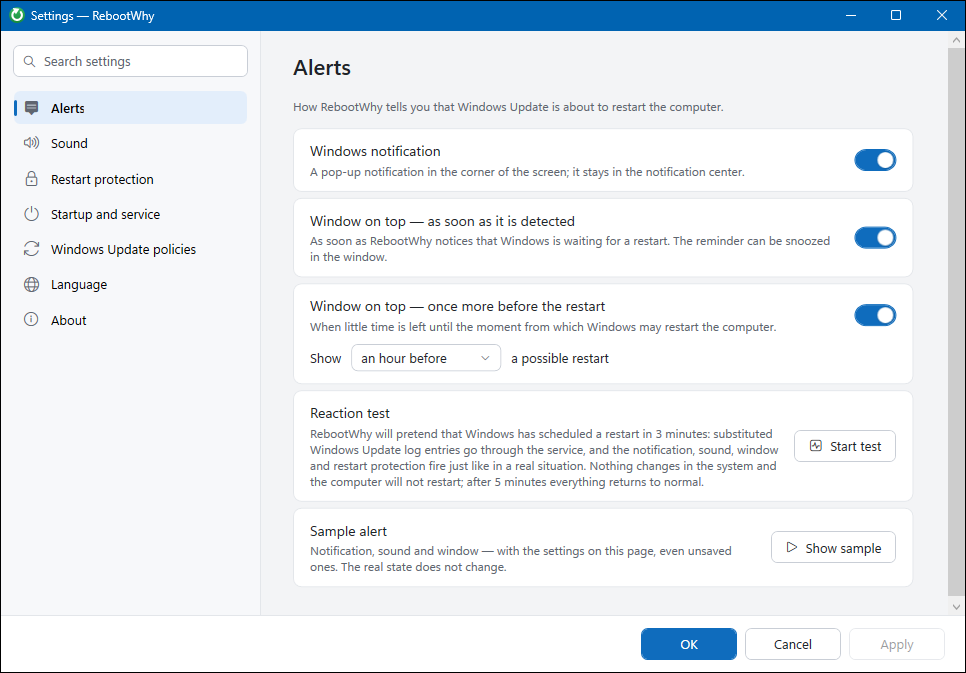

  

<h1 align="center">RebootWhy</h1>

  <b>Why did my PC restart? And is Windows about to do it again?</b> 
  A small Windows app that explains every restart from the system logs and warns you <i>before</i> Windows Update restarts your computer.

  
  
  
  

  <b>English</b> · <a href="README.ru.md">Русский</a> · <a href="README.uk.md">Українська</a> · <a href="README.hy.md">Հայերեն</a>

  

## The story

You leave your PC on overnight with work open. In the morning it's sitting at the lock screen: Windows restarted it at 01:30 to install a display driver. The Windows settings app says nothing. Event Viewer has thousands of entries. And nothing warned you beforehand.

RebootWhy answers both questions:

* **After the fact:** *what* restarted the computer, *who* asked for it and *why*, with the exact log events as proof.
* **Ahead of time:** whether Windows Update is waiting for a restart, *when* it may happen and *why Windows thinks it's allowed*, plus a loud warning while there is still time to save your work.

## Features

### Restart history with causes

* Uptime, last full boot and active time without sleep, with Fast Startup and hibernation taken into account (a "Shut down" with Fast Startup isn't a real restart).
* Every boot in the chosen period gets a plain-language cause:
  * **Windows Update** (automatic or started by you from the notification), with the list of updates installed before it;
  * **you**, from the Start menu or by pressing the power button;
  * a **command** (`shutdown.exe`), an **installer** or an **application**, with the process path, the user and the shutdown reason code;
  * **blue screen** with the bugcheck name, a short explanation and the memory dump path;
  * **power loss / hang / Reset button**, **power button held down**, **sleep/resume failure**, **resume from hibernation**;
  * hardware errors (WHEA) logged around the crash.
* A confidence level and the **log events the conclusion is based on**, so you can check it yourself.
* Open an exported `.evtx` log from **another computer** and analyze it the same way.
* One click copies the full explanation to the clipboard, ready for a forum post or a bug report.

### Windows Update watch and early warning

* Reads the logs of the Windows **Update Orchestrator**, the component that actually decides when to restart, and finds updates that are installed and waiting for a restart.
* Works out the **earliest time** a restart may happen: end of active hours plus the next run of the `Schedule Work` / `Schedule Wake To Work` tasks.
* Explains **why** Windows may restart without asking, e.g. *"the update is treated as approved by you earlier"*, *"overdue"*, *"postponed because you were using the computer"*.
* Warns the way you choose: a Windows notification, an **always-on-top window** (right when a pending restart is detected and again N minutes before), your own **sound** (mp3, wav or ogg), and **snooze** for a chosen time.
* **Keep the computer "in use"** while a restart is pending: Windows postpones automatic restarts while the user is active. Manual restarts are never blocked.
* A tray icon that turns **red** when a restart is pending.
* **Reaction test:** simulate a pending update with a restart in 3 minutes to check your notifications. Nothing is changed in Windows and no real restart happens.

### Updates tab

* Full **installation history**: date, result, error code with an explanation, who started it, KB article and links.
* **Updates Windows already knows about but hasn't installed yet**. Rows are tinted **red** if the update will need a restart and **orange** if it may need one.
* Instant search by title, KB number or description, and filters such as "Windows and drivers only" and "Restart required only".

### Windows Update policies in one place

Toggle the policies that matter, with admin rights:

* **No auto-restart with logged-on users** (`NoAutoRebootWithLoggedOnUsers`);
* **Do not include drivers with Windows updates** (`ExcludeWUDriversInQualityUpdate`);
* **Automatic Updates mode** (notify / download / install on schedule).

### Optional background service

The app works on its own. With the optional Windows service, installed from the settings, you also get:

* the **exact** Task Scheduler schedule of Windows Update tasks, which only an administrator can read;
* monitoring that keeps running when nobody is signed in to the app;
* instant push updates to the tray app over a local named pipe.

  

## Why RebootWhy

| | |
|---|---|
| **Explains, not just lists** | Other tools show boot times. RebootWhy names the cause and shows the evidence. |
| **Warns before it happens** | It reads the same Update Orchestrator logs Windows uses to plan restarts, so you know before your work is lost. |
| **Works in any Windows language** | The analysis uses event IDs, fields and codes, not message texts. |
| **Private by design** | No network access, no telemetry, no account. Everything is read from local logs. |
| **Light and portable** | One self-contained `.exe`. No installer, no .NET runtime to install, no admin rights needed for the main features. |
| **Safe** | It only reads. The only things it can change are the Windows Update policies you toggle yourself and the optional service. |
| **Open source, MIT** | Tested on synthetic logs and on real Update Orchestrator logs from an actual unwanted night-time restart. |

## Screenshots

| Updates | Settings |
|---|---|
|  |  |

## Download and run

1. Download `RebootWhy.exe` from the [latest release](../../releases/latest).
2. Run it. There's nothing to install, and the .NET runtime is built in.
   *Windows SmartScreen may warn about an unknown publisher because the exe isn't code-signed. Choose "More info → Run anyway", or [build it yourself](docs/BUILDING.md).*
3. Optional: in **Settings → Startup and service**, turn on *Start RebootWhy when signing in to Windows* and install the background service. Then pick the warnings you want under **Alerts**.

Requirements: Windows 10 or 11, x64. Developed and tested on Windows 11.

Command-line modes of the same exe:

| Command | What it does |
|---|---|
| `RebootWhy.exe` | Main window and the tray icon. Closing the window doesn't stop monitoring. |
| `RebootWhy.exe --tray` | Tray icon only (used when starting with Windows). |
| `RebootWhy.exe --service` | Windows service mode (installed from the settings). |

## FAQ

**Will RebootWhy stop Windows from restarting?**
It can make it much less likely. It warns you early, it can keep the session "in use" while a restart is pending, and it lets you turn on the *no auto-restart with logged-on users* policy. Windows Update can still restart the computer in some cases, though. That's why the warning exists.

**Does it block me from restarting manually?**
No. Restarts from the Start menu, the power button or `shutdown.exe` work as usual.

**Does it need administrator rights?**
Not for the history, the updates list or the warnings. Admin rights are needed only to install the service and to change Windows Update policies, and Windows will ask for them (UAC).

**Does it send anything anywhere?**
No. RebootWhy doesn't use the network. Even the "known updates" list comes from the local Windows Update database, without contacting Microsoft servers.

**How accurate is the restart forecast?**
The Update Orchestrator log format is undocumented. RebootWhy relies on what Windows actually writes, checked against real logs. If the format changes, the app says it could not check rather than silently showing "all clear". With the service installed, the schedule is read from Task Scheduler and is exact.

**How do I analyze another computer?**
On that computer, run `wevtutil epl System C:\logs\System.evtx`, copy the file and open it in RebootWhy (*Open .evtx log…* on the Restarts tab).

## Documentation

* [How it works](docs/HOW-IT-WORKS.md): how causes are determined and how restarts are predicted.
* [Building from source](docs/BUILDING.md)
* [Development guide](docs/DEVELOPMENT.md): architecture, localization, tests, debugging.
* [Contributing](CONTRIBUTING.md) · [Security](SECURITY.md) · [Changelog](CHANGELOG.md)

## License

[MIT](LICENSE) © 2026 Georgiy Garnov
