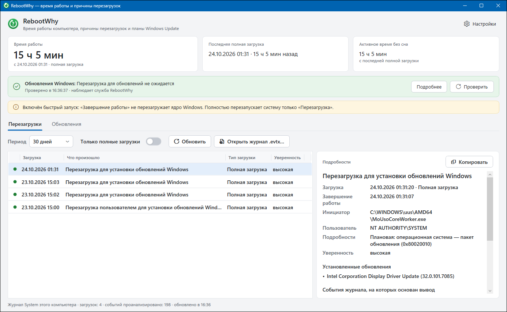
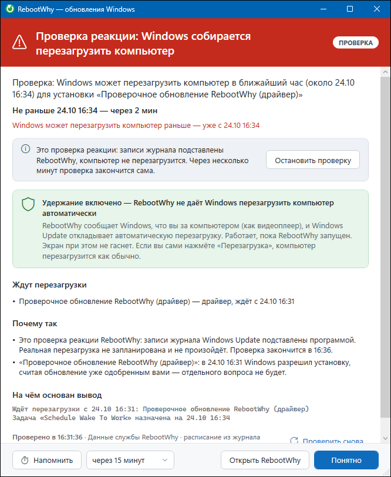
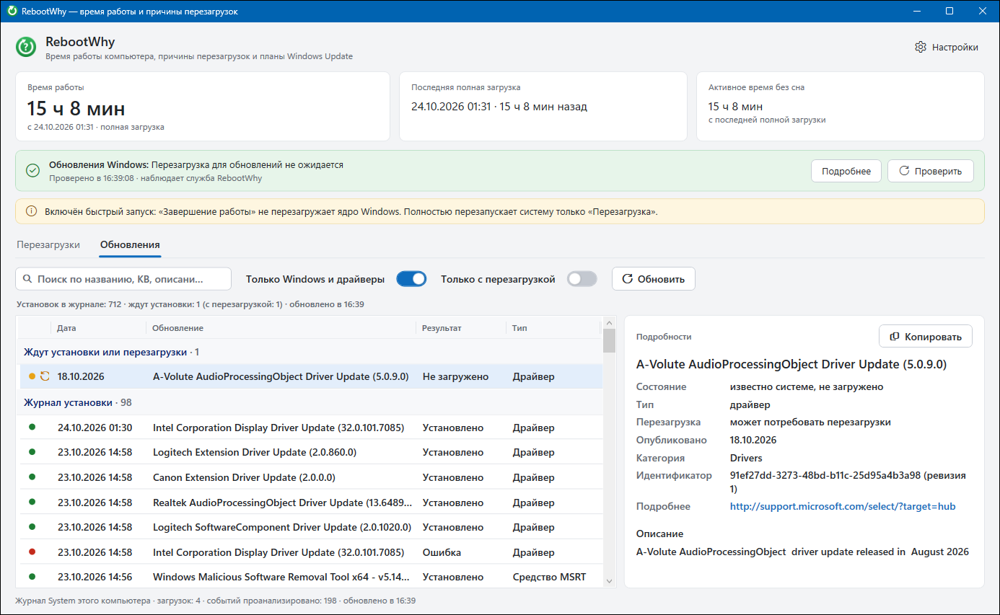
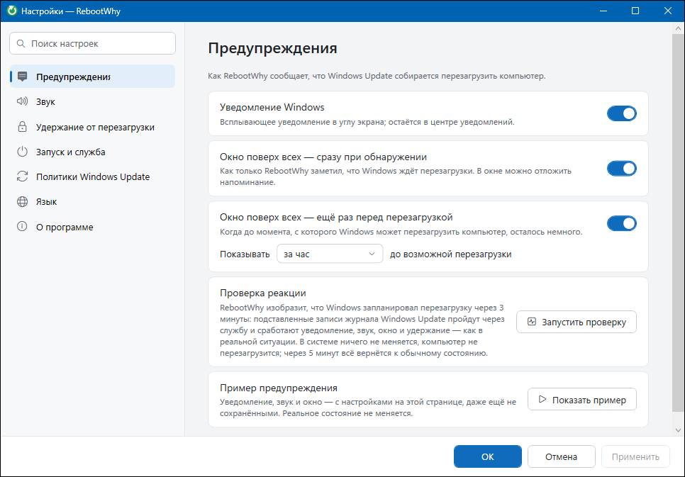

  

<h1 align="center">RebootWhy</h1>

  <b>Почему перезагрузился компьютер? И не собирается ли Windows сделать это снова?</b> 
  Небольшая программа для Windows: объясняет каждую перезагрузку по системным журналам и предупреждает <i>заранее</i>, что Windows Update собирается перезагрузить компьютер.

  
  
  

  <a href="README.md">English</a> · <b>Русский</b> · <a href="README.uk.md">Українська</a> · <a href="README.hy.md">Հայերեն</a>

  

## Откуда взялась программа

Вы оставили компьютер на ночь с открытой работой. Утром на экране вход в систему: Windows перезагрузила его в 01:30 ради драйвера видеокарты. В параметрах Windows об этом ни слова, в «Просмотре событий» тысячи записей, и заранее никто не предупредил.

RebootWhy отвечает на оба вопроса:

* **После:** *что* перезагрузило компьютер, *кто* это запросил и *почему*, с событиями журнала в качестве доказательства.
* **До:** ждёт ли Windows Update перезагрузки, *когда* она может случиться и *почему Windows считает, что можно не спрашивать*. И громко предупреждает, пока ещё есть время сохранить работу.

## Возможности

### История перезагрузок с причинами

* Время работы, последняя полная загрузка и активное время без сна. Быстрый запуск и гибернация учитываются: «Завершение работы» с быстрым запуском не перезапускает ядро.
* Для каждой загрузки за выбранный период причина простыми словами:
  * **Windows Update** (сам или по вашей команде из уведомления) и список обновлений, установленных перед перезагрузкой;
  * **вы** — из меню «Пуск» или кнопкой питания;
  * **команда** (`shutdown.exe`), **установщик** или **программа** — с путём процесса, пользователем и кодом причины;
  * **синий экран** — название ошибки, пояснение и путь к дампу памяти;
  * **пропало питание / зависание / кнопка Reset**, **удержание кнопки питания**, **сбой сна**, **выход из гибернации**;
  * аппаратные ошибки (WHEA) рядом со сбоем.
* Уверенность вывода и **события журнала, на которых он основан**: всё можно проверить самому.
* Можно открыть `.evtx`-журнал **с другого компьютера**.
* Одна кнопка копирует объяснение целиком — для форума или обращения в поддержку.

### Наблюдение за Windows Update и предупреждение заранее

* Читает журналы **Update Orchestrator** — компонента Windows, который на самом деле решает, когда перезагружать, — и находит установленные обновления, которые ждут перезагрузки.
* Вычисляет, **когда** перезагрузка возможна: конец активных часов и ближайший запуск задач `Schedule Work` / `Schedule Wake To Work`.
* Объясняет, **почему** Windows может перезагрузить без вопроса: «обновление считается одобренным вами ранее», «просрочено», «отложено, пока вы за компьютером».
* Предупреждает так, как вы настроите: уведомление Windows, **окно поверх всех** (сразу при обнаружении и ещё раз за N минут), **свой звук** (mp3, wav, ogg) и **«Напомнить через…»**.
* **Удерживает компьютер «занятым»**, пока Windows ждёт перезагрузки: при активном пользователе Windows откладывает автоматическую перезагрузку. Ручную перезагрузку это не блокирует.
* Значок в трее **краснеет**, когда Windows ждёт перезагрузки.
* **Проверка реакции:** имитирует обновление с перезагрузкой через 3 минуты, чтобы проверить уведомления. В Windows ничего не меняется, настоящей перезагрузки не будет.

### Вкладка «Обновления»

* Весь **журнал установки**: дата, результат, код ошибки с расшифровкой, кто запустил, статья KB, ссылки.
* **Обновления, о которых Windows уже знает, но ещё не установила.** Строки подсвечены **красным**, если перезагрузка потребуется, и **оранжевым**, если может потребоваться.
* Мгновенный поиск по названию, номеру KB и описанию, фильтры «Только Windows и драйверы» и «Только с перезагрузкой».

### Политики Windows Update в одном месте

С правами администратора:

* **Не перезагружать автоматически при вошедшем пользователе** (`NoAutoRebootWithLoggedOnUsers`);
* **Не получать драйверы вместе с обновлениями Windows** (`ExcludeWUDriversInQualityUpdate`);
* **Режим автоматического обновления** (уведомлять / загружать / устанавливать по расписанию).

### Служба (необязательно)

Программа работает и без неё. Служба, которая ставится из настроек, добавляет:

* **точное** расписание задач Windows Update из Планировщика — его видит только администратор;
* наблюдение, даже когда программа не запущена;
* мгновенную доставку изменений в программу через локальный именованный канал.

  

## Сильные стороны

| | |
|---|---|
| **Объясняет, а не перечисляет** | Другие утилиты показывают время загрузки. RebootWhy называет причину и показывает доказательства. |
| **Предупреждает до того, как** | Читает те же журналы Update Orchestrator, по которым Windows планирует перезагрузку, — вы узнаёте раньше, чем потеряете работу. |
| **Любой язык Windows** | Анализ опирается на коды и поля событий, а не на тексты сообщений. |
| **Приватно** | Никакой сети, телеметрии и учётных записей. Всё читается из локальных журналов. |
| **Лёгкая и переносимая** | Один `.exe` со всем необходимым: без установщика, без установки .NET, без прав администратора для основных функций. |
| **Безопасно** | Программа только читает. Меняет она лишь политики Windows Update, которые вы переключите сами, и необязательную службу. |
| **Открытый код, MIT** | Проверена на синтетических журналах и на настоящих журналах Update Orchestrator той самой ночной перезагрузки. |

## Скриншоты

| Обновления | Настройки |
|---|---|
|  |  |

## Скачать и запустить

1. Скачайте `RebootWhy.exe` со [страницы последнего выпуска](../../releases/latest).
2. Запустите. Устанавливать ничего не нужно, .NET уже внутри.
   *SmartScreen может предупредить о неизвестном издателе: exe не подписан. Нажмите «Подробнее → Выполнить в любом случае» или [соберите программу сами](docs/BUILDING.md).*
3. По желанию: в **Настройках** включите запуск вместе с Windows, установите службу и выберите способы предупреждения.

Требования: Windows 10 или 11, x64. Разрабатывается и проверяется на Windows 11. Язык интерфейса — английский, русский, украинский или армянский — выбирается в настройках.

Режимы запуска одного и того же exe:

| Команда | Что делает |
|---|---|
| `RebootWhy.exe` | Окно программы и значок в трее. Закрытие окна не останавливает наблюдение |
| `RebootWhy.exe --tray` | Только значок в трее (так программа стартует вместе с Windows) |
| `RebootWhy.exe --service` | Режим службы Windows (ставится из настроек) |

## Вопросы и ответы

**RebootWhy запретит Windows перезагружаться?**
Сильно снизит вероятность: предупредит заранее, может держать сеанс «занятым», пока Windows ждёт перезагрузки, и позволяет включить политику «не перезагружать при вошедшем пользователе». Но в некоторых случаях Windows Update всё же может перезагрузить компьютер — для этого и нужно предупреждение.

**Можно ли перезагрузиться вручную?**
Да. Перезагрузка из меню «Пуск», кнопкой питания или `shutdown.exe` работает как обычно.

**Нужны ли права администратора?**
Для истории, списка обновлений и предупреждений — нет. Они нужны только для установки службы и изменения политик Windows Update; Windows спросит их сама (UAC).

**Программа что-то отправляет?**
Нет. RebootWhy не пользуется сетью. Даже список известных обновлений берётся из локальной базы Windows Update, без обращения к серверам Microsoft.

**Насколько точен прогноз?**
Формат журналов Update Orchestrator не документирован. RebootWhy опирается на то, что Windows реально пишет, и проверена на настоящих журналах. Если формат изменится, программа скажет «не удалось проверить», а не «всё спокойно». Со службой расписание берётся из Планировщика и точно.

**Как разобрать перезагрузки другого компьютера?**
На нём выполните `wevtutil epl System C:\logs\System.evtx`, перенесите файл и откройте его в RebootWhy («Открыть журнал .evtx…»).

## Документация (на английском)

* [Как это работает](docs/HOW-IT-WORKS.md)
* [Сборка из исходников](docs/BUILDING.md)
* [Руководство разработчика](docs/DEVELOPMENT.md)
* [Как помочь проекту](CONTRIBUTING.md) · [Безопасность](SECURITY.md) · [Изменения](CHANGELOG.md)

## Лицензия

[MIT](LICENSE) © 2026 Georgiy Garnov
